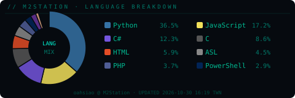

<!-- ═══════════════════════════════════════════════════════════════ -->
<!--  oahsiao · GitHub Profile README                              -->
<!--  SVGs auto-updated daily via GitHub Actions                   -->
<!-- ═══════════════════════════════════════════════════════════════ -->

---

---

### `M2STATION · MEMBER LEADERBOARD`

> Auto-generated daily from private org repositories via GitHub Actions

---

### `M2STATION · DAILY COMMIT TREND`

> All-repo daily commit volume over the last 90 days

---

### `M2STATION · LATEST 10 CHANGES`

> Newest commits across all org repos · click a commit to open the change

<!-- LATEST-CHANGES:START -->
01. [`M2_TIMELINE@8a74675`](https://github.com/M2Station/M2_TIMELINE/commit/8a746755bd7d4110c152f6afca92f101c7ab06e3) — feat(i18n): rename the Style A presentation to "Interacti... · `2026-10-31` · oahsiao
02. [`M2_TIMELINE@c9e5abc`](https://github.com/M2Station/M2_TIMELINE/commit/c9e5abcc5bc78a679a095f39acfaad8c2886889e) — style(ui): derive theme colours from tokens, enforce the ... · `2026-10-31` · oahsiao
03. [`M2_TIMELINE@6b96a31`](https://github.com/M2Station/M2_TIMELINE/commit/6b96a318545223b43a872cdcb31f0c78fd5a034d) — fix(diagram): keep event labels on one line at a uniform ... · `2026-10-31` · oahsiao
04. [`M2_TIMELINE@1566aba`](https://github.com/M2Station/M2_TIMELINE/commit/1566abad1271412df07205289875524a303831f0) — fix(diagram): show event date ranges as "start \| end", ke... · `2026-10-30` · oahsiao
05. [`M2_TIMELINE@4268294`](https://github.com/M2Station/M2_TIMELINE/commit/42682942c54b2797be934ebf27e820b5d6fac211) — build(php): target PHP 8.5 across the launcher, CI, and p... · `2026-10-30` · oahsiao
06. [`M2_SKILLS@3ea8df8`](https://github.com/M2Station/M2_SKILLS/commit/3ea8df882fd4ff070bdec7510a7bef211b7fab5d) — feat(m2-pr): extend auto mode with post-merge cleanup and... · `2026-10-30` · oahsiao
07. [`M2_SKILLS@f359066`](https://github.com/M2Station/M2_SKILLS/commit/f359066ef442039c167e798af964424626866cc9) — feat(m2-commit): add auto mode for unattended commit and ... · `2026-10-30` · oahsiao
08. [`M2_TIMELINE@7e9930a`](https://github.com/M2Station/M2_TIMELINE/commit/7e9930a6e41f0bbc6db8a3d2629d38f869e573ea) — fix(test): resolve the short 8.3 temp path in the API test · `2026-10-30` · oahsiao
09. [`M2_TIMELINE@d495708`](https://github.com/M2Station/M2_TIMELINE/commit/d4957086cbd4307e80635e6b70163a1ac7711f06) — fix(ci): move the verify workflow to the repository root · `2026-10-30` · oahsiao
10. [`M2_TIMELINE@6c2726a`](https://github.com/M2Station/M2_TIMELINE/commit/6c2726a0823510b50faefe12a9ffc2f84b526a69) — fix(ci): make the verify workflow run, and fix the deploy... · `2026-10-30` · oahsiao
<!-- LATEST-CHANGES:END -->

---

### `ACTIVITY`

---

<code>AUTO-SYNC DAILY 10:00 TWN</code>
 

