<!-- ═══════════════════════════════════════════════════════════════ -->
<!--  oahsiao · GitHub Profile README                              -->
<!--  SVGs auto-updated daily via GitHub Actions                   -->
<!-- ═══════════════════════════════════════════════════════════════ -->

---

---

### `M2STATION · MEMBER LEADERBOARD`

> Auto-generated daily from private org repositories via GitHub Actions

---

### `M2STATION · DAILY COMMIT TREND`

> All-repo daily commit volume over the last 90 days

---

### `M2STATION · LATEST 10 CHANGES`

> Newest commits across all org repos · click a commit to open the change

<!-- LATEST-CHANGES:START -->
01. [`M2_TIMELINE@1bb851e`](https://github.com/M2Station/M2_TIMELINE/commit/1bb851eba8d789e4e7f3851c3d95f92d789e3e03) — docs(ui): highlight the three quality principles (#84) · `2026-11-14` · oahsiao
02. [`M2_TIMELINE@8dab632`](https://github.com/M2Station/M2_TIMELINE/commit/8dab632f314486d5717c622f2b8c256609ecfeb3) — docs(ui): add UIUX optimization reference (#83) · `2026-11-14` · oahsiao
03. [`M2_TIMELINE@6d93fae`](https://github.com/M2Station/M2_TIMELINE/commit/6d93fae84c50353d7ffdec21e09282c07d1cf1c4) — perf(templates): paginate snapshots and clean preview cac... · `2026-11-14` · oahsiao
04. [`M2_TIMELINE@b0c2119`](https://github.com/M2Station/M2_TIMELINE/commit/b0c211903d7ee72a311e4d4b69b54cfe184e7348) — perf(ui): cache project previews and paginate template sn... · `2026-11-14` · oahsiao
05. [`M2_TIMELINE@82c9b09`](https://github.com/M2Station/M2_TIMELINE/commit/82c9b094cef388c4c1fd2a2e5d56b85b71fb0e13) — fix(ui): polish project thumbnails and chart export edges... · `2026-11-14` · oahsiao
06. [`M2_TIMELINE@31adf00`](https://github.com/M2Station/M2_TIMELINE/commit/31adf00192f0ecebc9e53789a0ab321912f28519) — feat(ui): add chart output for overview presentations (#79) · `2026-11-14` · oahsiao
07. [`M2_TIMELINE@b8b3c81`](https://github.com/M2Station/M2_TIMELINE/commit/b8b3c8155e1249e7e4e52061df7e81b7a80a45c5) — feat(workspace): add template snapshots and project thumb... · `2026-11-14` · oahsiao
08. [`M2_TIMELINE@e2d8023`](https://github.com/M2Station/M2_TIMELINE/commit/e2d8023e6c0509bc25286713a1172260d402fde2) — feat(ui): finish the final workspace polish audit (#77) · `2026-11-14` · oahsiao
09. [`M2_TIMELINE@f23e65f`](https://github.com/M2Station/M2_TIMELINE/commit/f23e65f2391a1ffe7977edd6394843f7f8f93c1f) — feat(ui): polish persistent state and workspace shells (#76) · `2026-11-14` · oahsiao
10. [`M2_TIMELINE@7d0dc8e`](https://github.com/M2Station/M2_TIMELINE/commit/7d0dc8e8045c56fedeba344878ed5785f1180f48) — fix(ui): guard admin actions until auth is ready (#75) · `2026-11-14` · oahsiao
<!-- LATEST-CHANGES:END -->

---

### `ACTIVITY`

---

<code>AUTO-SYNC DAILY 10:00 TWN</code>
 

