<!-- ═══════════════════════════════════════════════════════════════ -->
<!--  oahsiao · GitHub Profile README                              -->
<!--  SVGs auto-updated daily via GitHub Actions                   -->
<!-- ═══════════════════════════════════════════════════════════════ -->

---

---

### `M2STATION · MEMBER LEADERBOARD`

> Auto-generated daily from private org repositories via GitHub Actions

---

### `M2STATION · DAILY COMMIT TREND`

> All-repo daily commit volume over the last 90 days

---

### `M2STATION · LATEST 10 CHANGES`

> Newest commits across all org repos · click a commit to open the change

<!-- LATEST-CHANGES:START -->
01. [`M2_GITHUB_ADMIN@9674a56`](https://github.com/M2Station/M2_GITHUB_ADMIN/commit/9674a568cc85de941d652082b332b1b30ca3ec8e) — Fix M2_P2P_DB BACKUP 失敗 · `2026-11-24` · oahsiao
02. [`M2_TIMELINE@4780474`](https://github.com/M2Station/M2_TIMELINE/commit/4780474590295a3f78d40a7136b5fe7ca2391836) — feat(settings): rebuild project settings, header and conf... · `2026-11-24` · oahsiao
03. [`M2_PILOT@4c39092`](https://github.com/M2Station/M2_PILOT/commit/4c39092891147599ca66853d853a9bb9ce891c18) — Fix Intel MEInfo package discovery in Common Settings · `2026-11-24` · asuka-wu
04. [`M2_TIMELINE@2f2169e`](https://github.com/M2Station/M2_TIMELINE/commit/2f2169e6037e3239db13e31d9b986985ab4fe487) — feat(ms-proj): explain and auto-fix dependency date confl... · `2026-11-24` · oahsiao
05. [`M2_PILOT@72a4f86`](https://github.com/M2Station/M2_PILOT/commit/72a4f86779529ce1a7bee4c5bb5448e7a1828873) — Fix QC MFCI unlock to run without pwsh (#70) · `2026-11-24` · aaaaaayo
06. [`M2_TIMELINE@4c81b9b`](https://github.com/M2Station/M2_TIMELINE/commit/4c81b9b6e61e693a0eee066bf3f203fb7c7f9bd1) — perf(app): cut library, search and API latency (#117) · `2026-11-24` · oahsiao
07. [`M2_WIKI@fdbc3b5`](https://github.com/M2Station/M2_WIKI/commit/fdbc3b5c52c5337a2200a9d67693f8c046b7fbfa) — +++ · `2026-11-24` · oahsiao
08. [`M2_TIMELINE@c654728`](https://github.com/M2Station/M2_TIMELINE/commit/c654728c217739b3579a2f3672cafe17597da684) — fix(mcp): expose template revision history and restore to... · `2026-11-23` · oahsiao
09. [`M2_TIMELINE@7b6532c`](https://github.com/M2Station/M2_TIMELINE/commit/7b6532c83ab0a6aa0eaddf7099a82df034a3c0a5) — feat(ms-proj): sync dependents and convert MSPDI imports ... · `2026-11-23` · oahsiao
10. [`.github@94f9cb5`](https://github.com/M2Station/.github/commit/94f9cb5468dbf081e8c9062c92e8d8f0170d6bfa) — chore: sync latest changes [skip ci] · `2026-11-23` · github-actions[bot]
<!-- LATEST-CHANGES:END -->

---

### `ACTIVITY`

---

<code>AUTO-SYNC DAILY 10:00 TWN</code>
 

