<!-- ═══════════════════════════════════════════════════════════════ -->
<!--  oahsiao · GitHub Profile README                              -->
<!--  SVGs auto-updated daily via GitHub Actions                   -->
<!-- ═══════════════════════════════════════════════════════════════ -->

---

---

### `M2STATION · MEMBER LEADERBOARD`

> Auto-generated daily from private org repositories via GitHub Actions

---

### `M2STATION · DAILY COMMIT TREND`

> All-repo daily commit volume over the last 90 days

---

### `M2STATION · LATEST 10 CHANGES`

> Newest commits across all org repos · click a commit to open the change

<!-- LATEST-CHANGES:START -->
01. [`M2_TIMELINE@29468e4`](https://github.com/M2Station/M2_TIMELINE/commit/29468e4e5f3e4e67af91d67d6ae53328febe941b) — feat(stage): replace the STAGE strip with a searchable Co... · `2026-11-21` · oahsiao
02. [`M2_TIMELINE@66bdce7`](https://github.com/M2Station/M2_TIMELINE/commit/66bdce7aa9597905e403c7373fa54263cf684b1d) — perf(ms-proj): optimize 300+ EVENT scheduling and full-he... · `2026-11-21` · oahsiao
03. [`.github@1663a53`](https://github.com/M2Station/.github/commit/1663a53e5c15cba35bb6ef26edbf4562cac5b154) — chore: sync latest changes [skip ci] · `2026-11-21` · github-actions[bot]
04. [`M2_SKILLS@0384713`](https://github.com/M2Station/M2_SKILLS/commit/0384713dffadb2a90b2ebcfc8ba662b7263dfec5) — auto backup · `2026-11-21` · testpc
05. [`M2_TIMELINE@7f405dc`](https://github.com/M2Station/M2_TIMELINE/commit/7f405dcf6675d38198616e19da625f1f4496236b) — feat(ms-proj): timeline navigator, STAGE color picker and... · `2026-11-21` · oahsiao
06. [`M2_SKILLS@88e2af3`](https://github.com/M2Station/M2_SKILLS/commit/88e2af3fe8303cd5723124c26f1319f303e0b158) — auto backup · `2026-11-21` · testpc
07. [`M2_SKILLS@f3ed59b`](https://github.com/M2Station/M2_SKILLS/commit/f3ed59b0d8908cbd4687937844ee9b8006c36858) — auto backup · `2026-11-21` · testpc
08. [`M2_TIMELINE@367e0d6`](https://github.com/M2Station/M2_TIMELINE/commit/367e0d6da48409af9c9f224ed6cc6491ae1051e2) — feat(ms-proj): STAGE dependencies, schedule impact review... · `2026-11-20` · oahsiao
09. [`M2_TIMELINE@2e7b911`](https://github.com/M2Station/M2_TIMELINE/commit/2e7b9119dc0d99ce3d2bba69f5a54d1b0612284e) — ++ · `2026-11-20` · oahsiao
10. [`M2_TIMELINE@75d2799`](https://github.com/M2Station/M2_TIMELINE/commit/75d2799ada2dee5e2da95f3914658278de58e41e) — ++ · `2026-11-20` · oahsiao
<!-- LATEST-CHANGES:END -->

---

### `ACTIVITY`

---

<code>AUTO-SYNC DAILY 10:00 TWN</code>
 

