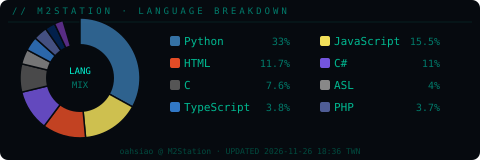

<!-- ═══════════════════════════════════════════════════════════════ -->
<!--  oahsiao · GitHub Profile README                              -->
<!--  SVGs auto-updated daily via GitHub Actions                   -->
<!-- ═══════════════════════════════════════════════════════════════ -->

---

---

### `M2STATION · MEMBER LEADERBOARD`

> Auto-generated daily from private org repositories via GitHub Actions

---

### `M2STATION · DAILY COMMIT TREND`

> All-repo daily commit volume over the last 90 days

---

### `M2STATION · LATEST 10 CHANGES`

> Newest commits across all org repos · click a commit to open the change

<!-- LATEST-CHANGES:START -->
01. [`M2_PUBLIC_RELEASE@d182dc0`](https://github.com/M2Station/M2_PUBLIC_RELEASE/commit/d182dc0f9b78eae7546337eeef2b30c9e2db80a0) — chore(m2-echo): publish v0.1.10 · `2026-11-26` · oahsiao
02. [`M2_PUBLIC_RELEASE@a1d51ae`](https://github.com/M2Station/M2_PUBLIC_RELEASE/commit/a1d51ae957fa980f461a6c28a454cda59dd35315) — chore(m2-echo): publish v0.1.9 · `2026-11-26` · oahsiao
03. [`M2_PUBLIC_RELEASE@1cc0e76`](https://github.com/M2Station/M2_PUBLIC_RELEASE/commit/1cc0e76ae7b6933fc849cdd3fdf59e177f894fb0) — chore(m2-echo): publish v0.1.8 · `2026-11-26` · oahsiao
04. [`M2_PUBLIC_RELEASE@8c3afa9`](https://github.com/M2Station/M2_PUBLIC_RELEASE/commit/8c3afa9a61b5ddaf7ef9d556027d944ccf3d5b4c) — chore(m2-echo): publish v0.1.7 · `2026-11-26` · oahsiao
05. [`M2_WIKI@da71ef6`](https://github.com/M2Station/M2_WIKI/commit/da71ef66dd565adf6e3ed04995ccce2d429e4070) — update the auto logon steps · `2026-11-26` · Sam6Su
06. [`M2_PUBLIC_RELEASE@05bc26a`](https://github.com/M2Station/M2_PUBLIC_RELEASE/commit/05bc26a41bbd81cc1e5dc577f9483b0e173f9bc0) — chore(m2-echo): publish v0.1.6 · `2026-11-26` · oahsiao
07. [`M2_PUBLIC_RELEASE@c37f6cb`](https://github.com/M2Station/M2_PUBLIC_RELEASE/commit/c37f6cb75b63109098fb726d5774a5bb9f92b3ca) — chore(m2-echo): publish v0.1.5 · `2026-11-26` · oahsiao
08. [`M2_PUBLIC_RELEASE@982d6cc`](https://github.com/M2Station/M2_PUBLIC_RELEASE/commit/982d6cc783b541de658ceac20d9273fa3d608b30) — chore(m2-echo): publish v0.1.4 · `2026-11-26` · oahsiao
09. [`M2_PUBLIC_RELEASE@a2afb07`](https://github.com/M2Station/M2_PUBLIC_RELEASE/commit/a2afb07569d2f35c9d7ac0ef9ac58217dc0b9659) — chore(m2-echo): publish v0.1.3 · `2026-11-26` · oahsiao
10. [`M2_PUBLIC_RELEASE@475a9be`](https://github.com/M2Station/M2_PUBLIC_RELEASE/commit/475a9beb9c00adfbe8797643c8042384d6add5c9) — chore(m2-echo): publish v0.1.2 · `2026-11-26` · oahsiao
<!-- LATEST-CHANGES:END -->

---

### `ACTIVITY`

---

<code>AUTO-SYNC DAILY 10:00 TWN</code>
 

