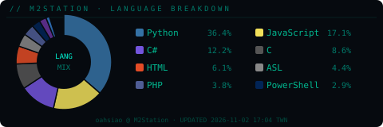

<!-- ═══════════════════════════════════════════════════════════════ -->
<!--  oahsiao · GitHub Profile README                              -->
<!--  SVGs auto-updated daily via GitHub Actions                   -->
<!-- ═══════════════════════════════════════════════════════════════ -->

---

---

### `M2STATION · MEMBER LEADERBOARD`

> Auto-generated daily from private org repositories via GitHub Actions

---

### `M2STATION · DAILY COMMIT TREND`

> All-repo daily commit volume over the last 90 days

---

### `M2STATION · LATEST 10 CHANGES`

> Newest commits across all org repos · click a commit to open the change

<!-- LATEST-CHANGES:START -->
01. [`M2_TIMELINE@e0a8d1a`](https://github.com/M2Station/M2_TIMELINE/commit/e0a8d1a610fe8e07c89533f8f2f5cf4aa1dd336c) — feat(ui): add a shortcut overlay and comparison minimap (... · `2026-11-14` · oahsiao
02. [`M2_TIMELINE@965aeb4`](https://github.com/M2Station/M2_TIMELINE/commit/965aeb4ecd8af5c766bba1af52af9d0fbe775001) — feat(ui): persist the timeline inspector and overflow pro... · `2026-11-14` · oahsiao
03. [`M2_TIMELINE@f0e6cce`](https://github.com/M2Station/M2_TIMELINE/commit/f0e6ccedd1d89d454c3a0ec13b597ac6cea5403e) — feat(ui): move comparison status filter into a View menu ... · `2026-11-14` · oahsiao
04. [`M2_TIMELINE@cc361eb`](https://github.com/M2Station/M2_TIMELINE/commit/cc361ebba129e21f55f40ad2eec471b61686fe71) — feat(ui): share the workspace page shell and compact list... · `2026-11-14` · oahsiao
05. [`M2_TIMELINE@3db3642`](https://github.com/M2Station/M2_TIMELINE/commit/3db3642cadd3d34d23029a7cb8dce6a291f0bddd) — feat(ui): compact the project library and workspace chrom... · `2026-11-14` · oahsiao
06. [`M2_TIMELINE@ca6fe73`](https://github.com/M2Station/M2_TIMELINE/commit/ca6fe731a192dc59067e2ddbcf18fa572fb4c293) — feat(ui): add a switchable timeline bottom inspector (#67) · `2026-11-14` · oahsiao
07. [`M2_TIMELINE@33afa2d`](https://github.com/M2Station/M2_TIMELINE/commit/33afa2d7dc854f8aff4aa86e4612f8aa5e01cb71) — feat(ui): compact settings navigation and schedule workbe... · `2026-11-14` · oahsiao
08. [`M2_TIMELINE@4eca7d4`](https://github.com/M2Station/M2_TIMELINE/commit/4eca7d41b4f5101fb17600ecdf7ea650905c6068) — feat(ui): compact phase diagrams, infographic and stage b... · `2026-11-14` · oahsiao
09. [`M2_TIMELINE@7ad4eac`](https://github.com/M2Station/M2_TIMELINE/commit/7ad4eac834bbb9c5e618aa30e6008a196a753a30) — feat(ui): align event timeline and Gantt with workspace t... · `2026-11-14` · oahsiao
10. [`M2_TIMELINE@ea7179f`](https://github.com/M2Station/M2_TIMELINE/commit/ea7179fcb540585f384b045841f45b0e344080a8) — fix(timeline): resolve stage edits and crop viewport expo... · `2026-11-13` · oahsiao
<!-- LATEST-CHANGES:END -->

---

### `ACTIVITY`

---

<code>AUTO-SYNC DAILY 10:00 TWN</code>
 

